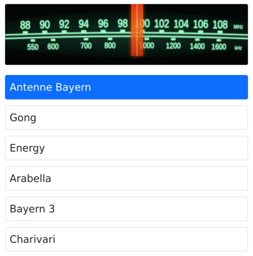

# RadioGaGa

A tiny internet radio for the Raspberry Pi, with a web page to switch stations from your phone.


## Introduction

I had no way to get normal radio reception in my kitchen, so I built my own: a Raspberry Pi connected to a speaker that plays an internet radio stream all day. At first I changed the station over SSH. Later I added a simple web page, so anyone on the home network can pick a station with one tap.

The project is deliberately small: two short Python scripts, one PHP page and a text file with your stations. There is no database and nothing to build. If you want something you can read and understand in ten minutes, this may be useful to you.



## How it works

- `radio/radio.list` holds your stations, one per line.
- `radio/active.txt` holds the number of the station that should be playing.
- `radio/keep_mplayer_alive.py` runs every minute from cron. If `mplayer` is not playing a stream, it starts the active station. This is also what starts the radio after a reboot or a dropped connection.
- `radio/kill_mplayer.py` stops `mplayer`.
- `html/index.php` shows the station list. When you tap a station, it writes the number to `active.txt`, stops `mplayer` and starts it again with the new station.

## Requirements

- A Raspberry Pi with a speaker on the audio jack and a network connection.
- Raspberry Pi OS 11 (bullseye). The project runs there with Python 2.7, PHP 7.4 and MPlayer 1.4.

Newer Raspberry Pi OS releases no longer ship Python 2, which the scripts need. An update to Python 3 is planned.

## Installation

The guide assumes your user is `pi` and the files live in `/home/pi/radio`. If you use a different user, see [Using a different path](#using-a-different-path).

1. Install the packages:
   ```bash
   sudo apt-get update
   sudo apt-get install apache2 php libapache2-mod-php python2 mplayer git
   ```

2. Switch the audio output to the headphone jack:
   ```bash
   sudo raspi-config
   ```
   Choose **System Options → Audio → Headphones**.

3. Get the code:
   ```bash
   cd ~
   git clone https://github.com/dimitriusM/RadioGaGa.git
   ```

4. Copy the scripts and the station list to your home directory:
   ```bash
   cp -r ~/RadioGaGa/radio /home/pi/radio
   ```

5. Copy the web page to the web server:
   ```bash
   sudo cp -r ~/RadioGaGa/html /var/www/html/radio
   ```

6. Let the web server change the active station:
   ```bash
   chmod +x /home/pi/radio/*.py
   sudo chown www-data /home/pi/radio/active.txt
   ```

7. Let the web server play audio:
   ```bash
   sudo usermod -a -G audio www-data
   sudo systemctl restart apache2
   ```

8. Start the radio every minute if it is not running. Open the crontab of the web server user:
   ```bash
   sudo crontab -u www-data -e
   ```
   Add this line:
   ```
   * * * * * python2 /home/pi/radio/keep_mplayer_alive.py
   ```

Within a minute the first station in your list starts playing.

## Usage

Open `http://<address-of-your-pi>/radio/` on any device in your home network and tap a station. The new station starts after a few seconds.

## Adding your own stations

Edit `/home/pi/radio/radio.list`. Each line has three parts separated by two underscores:

```
<number>__<name>__<stream URL>
```

For example:

```
1__Antenne Bayern__http://play.antenne.de/antenne.m3u
```

- The number must be unique. The order of the lines is the order on the web page.
- Keep one station with the number `1`. It is played when no station is selected.
- Playlist URLs (`.pls`, `.m3u`) and direct stream URLs both work.

The list in this repository is a short example with three stations from Bavaria. Stream URLs change from time to time; if a station stays silent, look for its current URL on the station's website.

## Using a different path

The path `/home/pi/radio` is written into two files. Change it in both:

- `radio/keep_mplayer_alive.py` (two places)
- `html/index.php` (the `$radioHomeDir` line at the top)

Use your path in the installation commands as well.

## Good to know

- The web page has no login. Use it in your home network only and do not expose it to the internet.
- The web page uses [Bootstrap](https://getbootstrap.com/) 5.2.3, which is included in `html/` and licensed under MIT.

## License

This project is licensed under the MIT License. See the [LICENSE](LICENSE) file for details.
